# Active Directory Home Lab

## Project Overview

Built and administered a virtualized Windows domain environment to practice foundational IT support, Windows Server administration, identity and access management, and troubleshooting. The lab uses a Windows Server domain controller and a domain-joined Windows 11 client to demonstrate user administration, DNS, Group Policy, and role-based file access.

**Domain:** `homelab.local`  
**Platform:** VMware Workstation Pro  
**Systems:** `DC01` (Windows Server, Active Directory Domain Services and DNS) and `CLIENT01` (Windows 11)

> This is an isolated educational lab using sample accounts and private network addresses, not a production enterprise environment.

## Objectives

* Deploy a domain controller and join a Windows client to the domain.
* Organize users and resources using Active Directory Organizational Units (OUs).
* Manage access using security groups rather than individual user permissions.
* Configure NTFS and SMB share permissions for departmental folders.
* Create a department-targeted Group Policy Object (GPO).
* Validate network connectivity, name resolution, and authorized versus denied access.

## Lab Architecture

|Component|Role|Configuration|
|-|-|-|
|VMware Workstation Pro|Virtualization|NAT virtual network|
|DC01|Domain controller and DNS server|`192.168.147.10` (static)|
|CLIENT01|Domain-joined workstation|Windows 11; DHCP-assigned address|
|Active Directory domain|Identity management|`homelab.local`|

The Windows client uses DC01 for DNS name resolution. The lab is hosted on a private VMware NAT network.

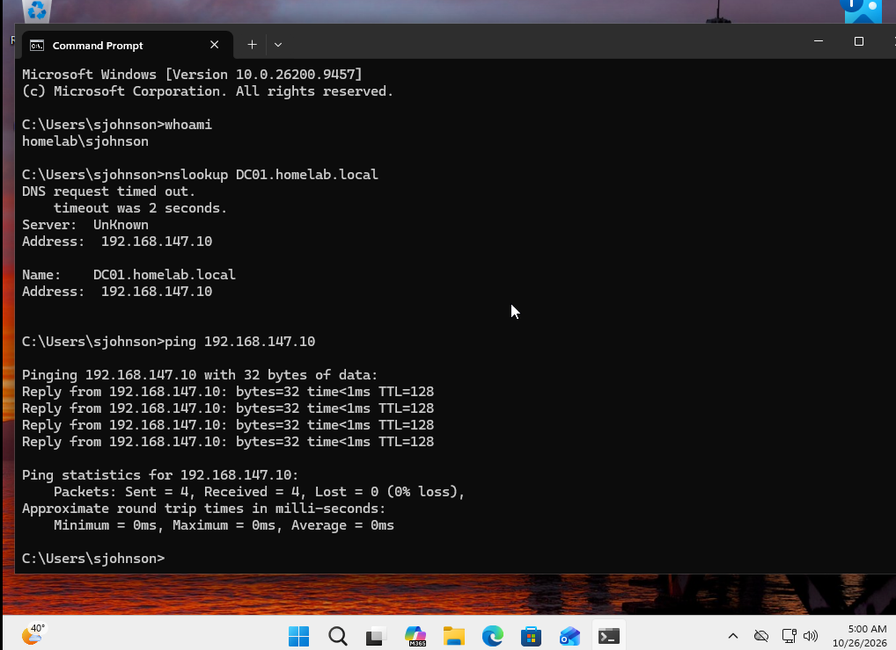

*Validation:* `whoami` returned `homelab\\sjohnson`, `nslookup DC01.homelab.local` resolved to `192.168.147.10`, and ping returned four replies with no packet loss. The DNS lookup showed an initial timeout, but the requested name ultimately resolved.

## Active Directory Organization

Created a `Homelab Technologies` OU with sub-OUs for computers, groups, servers, and users. The Users OU contains departmental OUs for Executive, Finance, HR, IT, and Sales.

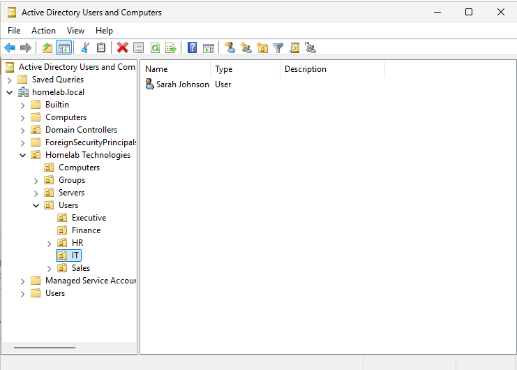

## Security Groups and Role-Based Access

Created `IT\_Admins` and `Finance Users` security groups to manage access to department resources. Verified that the sample IT user Sarah Johnson belongs to `IT\_Admins`.

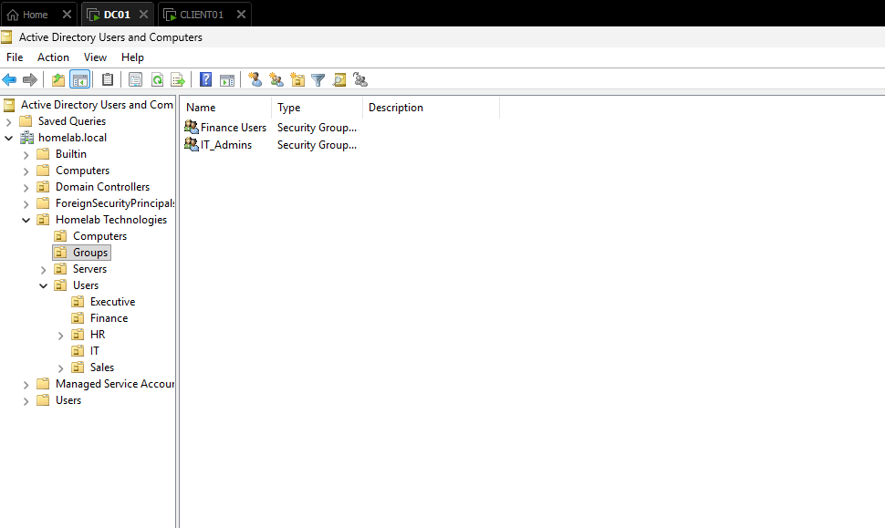

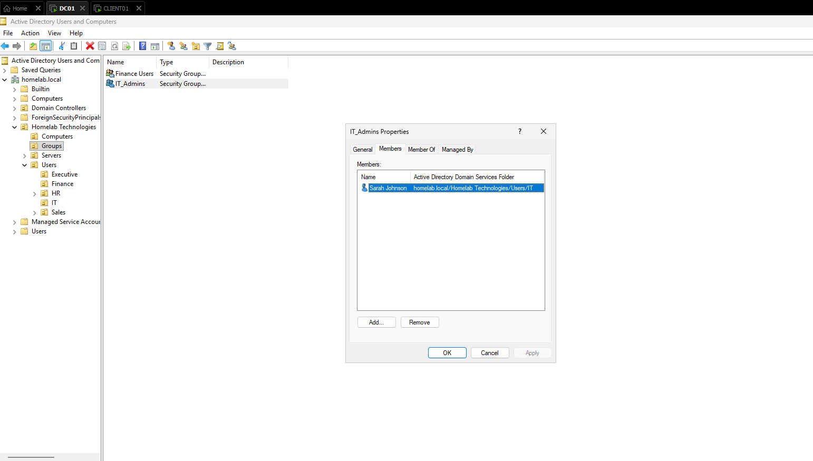

## Shared Folder Permissions

Configured departmental shared folders on DC01. For the IT folder, the `IT\_Admins` group has NTFS **Modify** permission; the SMB share grants **Everyone: Full Control**, leaving more granular restrictions to NTFS. The Finance folder grants the `Finance Users` group NTFS **Modify** permission.

When accessing files over SMB, both share and NTFS permissions apply. Effective access also depends on other applicable permissions and group memberships, so these screenshots demonstrate the configured group entries rather than proving exclusive access for every possible account.

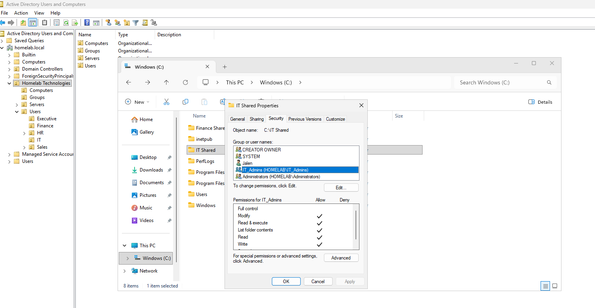

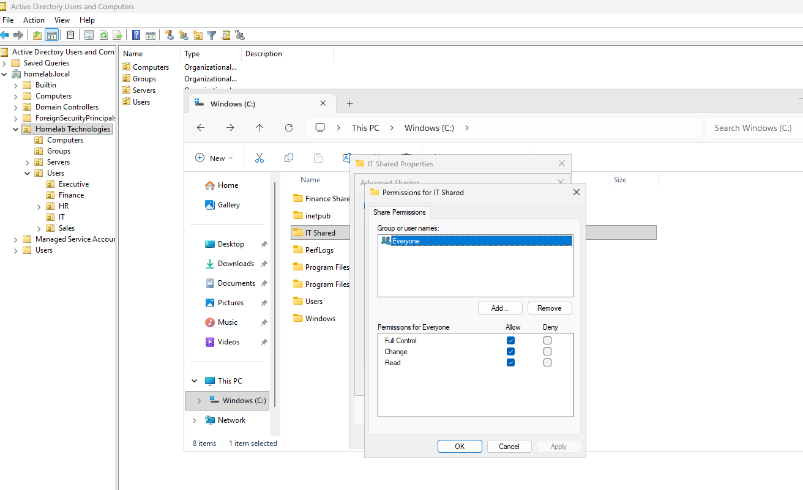

## Group Policy

Created the **Finance - 10 Minute Screen Lock** GPO and linked it to the Finance OU. Configured these user settings under **Administrative Templates → Control Panel/Personalization**:

|Setting|Value|
|-|-|
|Enable screen saver|Enabled|
|Password protect the screen saver|Enabled|
|Screen saver timeout|600 seconds|

The configuration is intended to protect unattended sessions. The screenshots establish the GPO's link and settings; client-side application should be separately validated with a Finance user using `gpresult /r` or an equivalent test.

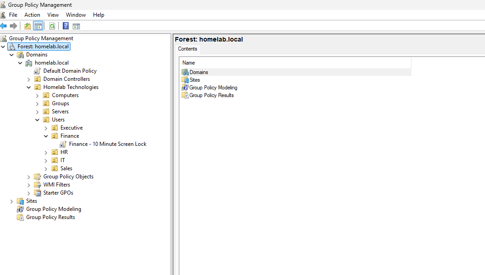

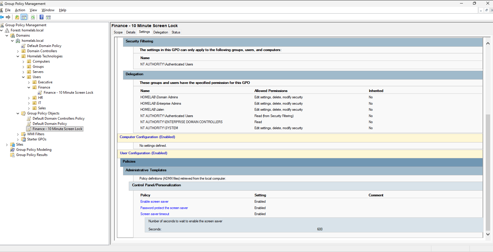

## Validation and Access Tests

* Confirmed a domain user session on CLIENT01 with `whoami`.
* Resolved the domain controller hostname with `nslookup`.
* Verified IP connectivity to DC01 using `ping`.
* Successfully opened `\\\\DC01\\IT Shared` as the sample IT user Sarah Johnson.
* Confirmed the same IT user received a permissions error when attempting to access `\\\\DC01\\Finance Shared`.

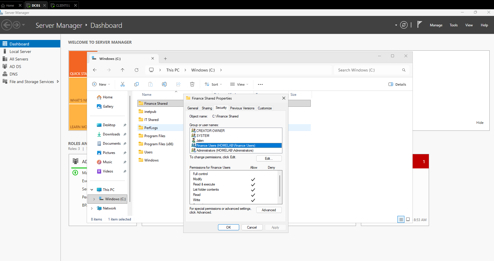

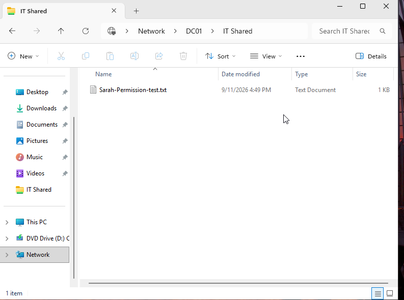

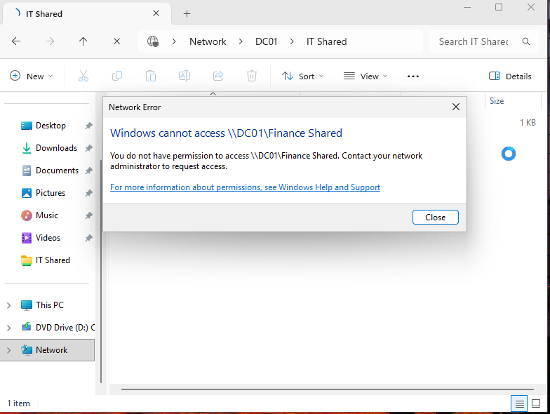

## Troubleshooting Skills Practiced

In guided lab exercises, practiced diagnosing DNS misconfiguration, missing or stale security-group membership in a logon token, share-versus-NTFS permission issues, disabled accounts, GPO filtering, and Windows temporary-profile errors. These exercises reinforced a repeatable workflow: collect the exact error, test one layer at a time, avoid unnecessary changes, protect user data, and verify the original symptom is resolved.

## Tools and Concepts

**Windows Server · Active Directory Domain Services · DNS · Windows 11 · VMware Workstation Pro · Group Policy Management · Active Directory Users and Computers · NTFS · SMB · RBAC · Least Privilege · `whoami` · `ipconfig` · `nslookup` · `ping` · `gpresult`**

## Future Improvements

* Verify Finance GPO application from a Finance user session and capture client-side evidence.
* Test access to Finance Shared using a Finance account.
* Review all applicable NTFS entries and effective access for additional user scenarios.
* Add a network diagram and a concise troubleshooting case study.

\---

*All names and addresses shown are from an isolated practice environment.*

